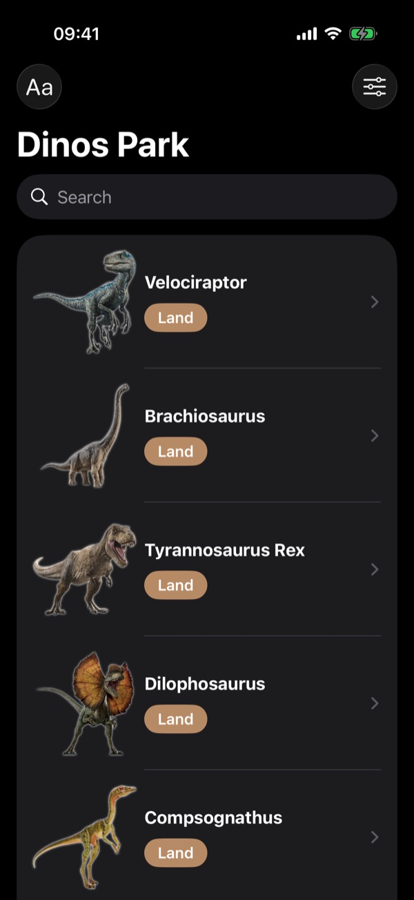
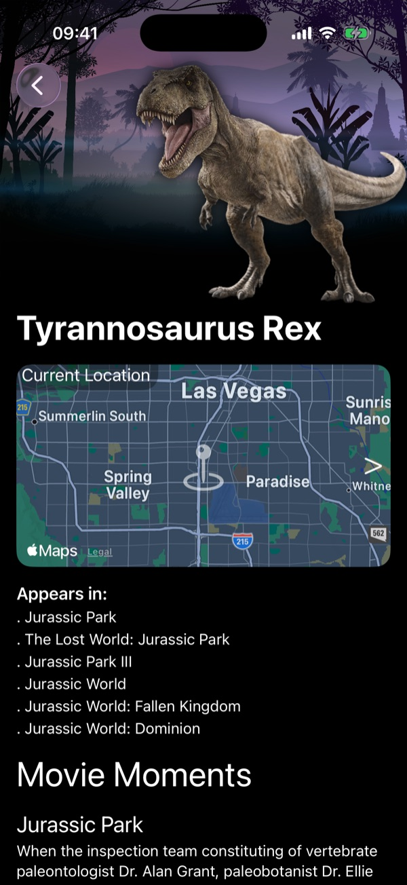
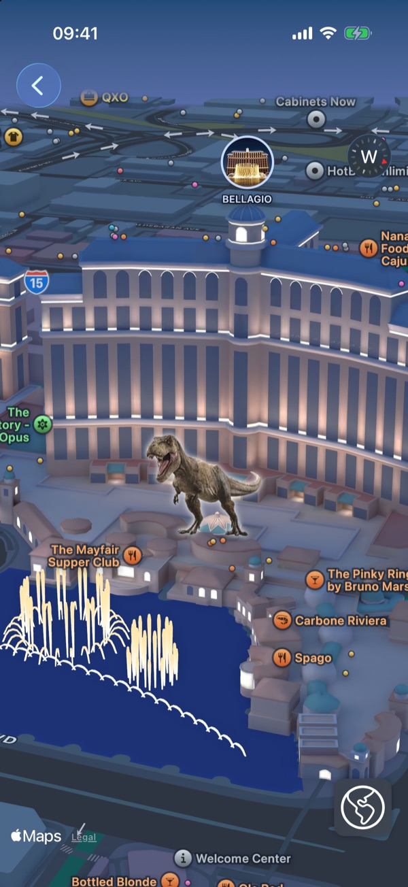

<h1 align="center">🦖 Dinos Park</h1>

<p align="center">
  A SwiftUI app that catalogs the apex predators of the <i>Jurassic Park</i> and <i>Jurassic World</i> movies, with search, filters, movie trivia and a 3D map of where each one was seen.
</p>

<p align="center">
  
  
  
  
</p>

<p align="center">
  
  &nbsp;
  
  &nbsp;
  
</p>

## Features

- **Catalog** of 21 predators with artwork and a land, air or sea badge
- **Search** by name, with animated results
- **Sort** alphabetically or by original order, and **filter** by type from a menu
- **Details** for each predator: habitat backdrop, live map preview of its location, the movies it appears in, memorable movie moments and a link to read more
- **3D map** with every predator pinned at its location, opened with a zoom transition, plus a toggle for realistic satellite imagery

## Tech stack

| | |
|---|---|
| UI | SwiftUI: `NavigationStack`, `searchable`, toolbar menus, symbol effects, zoom navigation transitions |
| Maps | MapKit for SwiftUI: `Map`, `Annotation`, `MapCamera`, standard and realistic imagery styles |
| Data | `Codable` models decoded from a bundled JSON file |
| Platform | iOS 26.5+, Swift 6 |

## Project structure

```
DinosPark/DinosPark/
├── DinosParkApp.swift
├── main/
│   ├── ContentView.swift        # List, search, sorting and filters
│   ├── Predators.swift          # Loads, searches, sorts and filters the data
│   └── model/ApexPredator.swift # Predator, movie and scene models
├── details/
│   └── PredatorDetail.swift     # Detail screen
├── map/
│   └── PredatorMap.swift        # 3D map with every predator
└── jpapexpredators.json         # Bundled data
```

## Getting started

1. Clone the repository:
   ```bash
   git clone https://github.com/filizzolalucca/DinosParK.git
   ```
2. Open `DinosPark/DinosPark.xcodeproj` in Xcode 26 or later.
3. Pick an iPhone simulator and press **⌘R**.

## Disclaimer

This is a fan project made for learning and portfolio purposes. *Jurassic Park*, *Jurassic World* and related names belong to Universal Pictures and Amblin Entertainment.

## Author

**Lucca Filizzola** · [@filizzolalucca](https://github.com/filizzolalucca)
